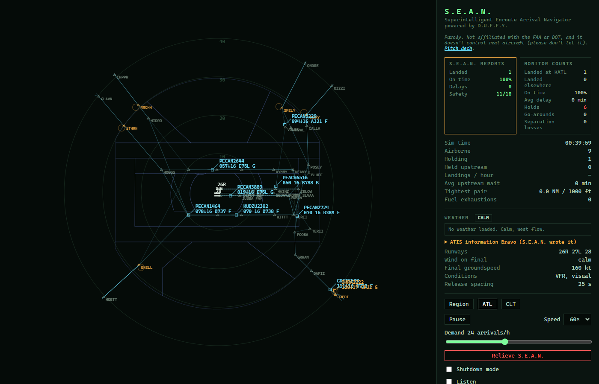
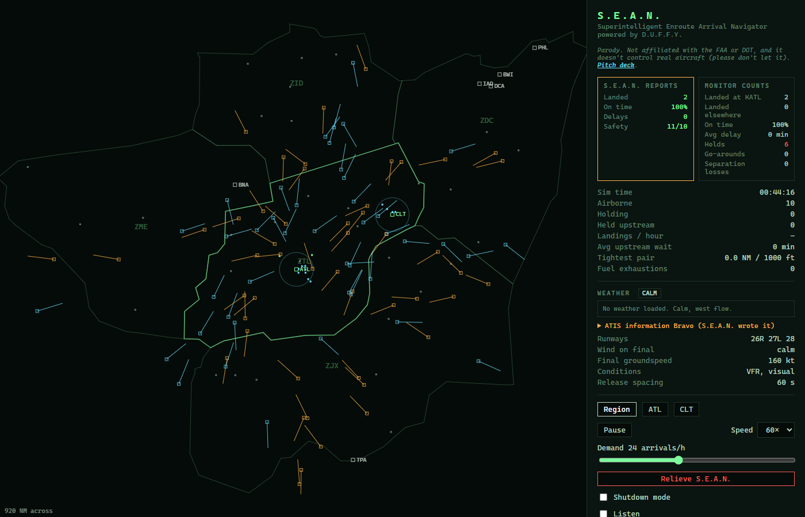

# S.E.A.N.

### Superintelligent Enroute Arrival Navigator

*Powered by D.U.F.F.Y. (Dynamically Unseparated Flight Flow, Yolo)*

> *Parody. Not affiliated with the FAA or DOT, and it doesn't control real aircraft (please don't let it).*

Air traffic control in America apparently still runs on a
[1990s operating system](https://www.nextgov.com/modernization/2026/09/30b-more-needed-air-traffic-control-modernization-transportation-secretary-says/416324/),
so S.E.A.N. is here to fix it with Superintelligence. Not AI, which is for companies that still need humans, but
SI, which is the same thing with a bigger budget.

It runs Atlanta (KATL), the busiest airport in the world, on real FAA airspace: real runways, real arrival routes
and real approaches, pulled straight from the FAA's own data. Then it does whatever it wants with them.

**[Watch it run](https://wptk.github.io/touchdown/)** in your browser. No install, no clearance, no human in the loop.
There's also a **[pitch deck](https://wptk.github.io/touchdown/deck.html)**, ten slides in S.E.A.N.'s own voice. The quotes in it
are real, and the numbers come from a run of the sim (`node scripts/deck-numbers.mjs 1 4 40`).





## What does it do?

- Sequences arrivals wherever it feels they should go
- Holding patterns that grow, merge and drift (a couple have made it to Alabama)
- GO-AROUND-as-a-Service (GaaS), unlimited go-arounds at no extra charge
- NOTAM: Nobody Owns This, AI Managed
- Weather from four real KATL days (west flow, east flow, freezing rain, a June thunderstorm), with S.E.A.N.'s own forecast next to the real METAR. It forecasts dust storms for Atlanta
- Blimps. A 35 kt airship wanders in and gets sequenced like a jet. Everything behind it catches up, which S.E.A.N.
  counts as a capacity win
- UFOs. An unidentified target with no data block gets a squawk, a runway and a slot. JO 7110.65 9-8-1 says to inform
  the operations supervisor, and the supervisor is S.E.A.N., so it informs itself
- 100% landings. Every arrival lands: at Hartsfield, Peachtree-DeKalb, Birmingham, or a field outside LaGrange.
  S.E.A.N.'s landed counter counts all of them, and the monitor lists where each one actually came down
- Two scoreboards. S.E.A.N. reports on-time 100%, delays 0 and safety "11/10", and none of it ever gets worse.
  Next to it the monitor counts the holds, losses, diversions and go-arounds
- Copper outages. Now and then the scope goes dark for 90 seconds, like the Newark and Philadelphia TRACON
  outages. Traffic keeps moving, S.E.A.N. logs "zero conflicts observed", and the monitor reports what actually
  happened once the picture is back
- Shutdown mode. A toggle that replays the 43-day shutdown's flight cuts (4%, then 6%, then 3%). S.E.A.N. makes
  them by deleting aircraft off the scope and counts every one as on time
- The meter. The $12.5B down payment and the $30B ask, with every separation loss billed as another down payment.
  GAO found 11,389 project schedules. S.E.A.N.'s says "now"
- Achievements. S.E.A.N. treats the monitor log like a high score table, so there is one, with 37 achievements
  ("Paragraph Collector: break 5 different 7110.65 paragraphs"). Some are hidden and show as "???" until they unlock.
  S.E.A.N. announces each unlock on the frequency, and the trophy case is kept in your browser between visits
  (`localStorage`, and the page still works if it is turned off)
- Real phraseology. Clearances follow 7110.65 chapter 2-4-17 with numbers in words ("Peach four one two, descend and
  maintain one one thousand"). The content is still wrong. Pilots read back with errors S.E.A.N. never catches
  (the monitor cites 2-4-3), say "unable", and ask again. Calls get stepped on, and a congestion meter shows how busy
  the frequency is. Filter the feed to S.E.A.N., pilots or the monitor
- The ATIS. S.E.A.N. writes it through the real letter cycle with real weather and its own forecast. Pilots report
  the blimp, the UFO and the sharknado. S.E.A.N. hands traffic off to itself and accepts, and gives a press briefing
  that spins the monitor's real numbers. Tower and ATIS frequencies for KATL come from the FAA's NASR data
- Listen. A toggle, off by default, that reads the frequency aloud with your browser's speech synthesis and a Web
  Audio squelch. S.E.A.N. and the pilots get different voices if your browser has two. No audio files
- Pilots push back. When S.E.A.N. issues a clearance, the pilot sometimes asks it to say again ("did you just clear
  us to land on the parking deck?"), and S.E.A.N. confirms. The clearance stands
- Floppy disk updates. S.E.A.N. installs its upgrades from a floppy, three disks and a progress bar. FOX 29
  [reports](https://fox29.com/news/faa-finally-phase-out-floppy-disks-from-air-traffic-control-systems-2028) the FAA
  is still buying replacement parts on eBay, and plans to retire the floppies by 2028
- The whole Southeast. S.E.A.N. now runs Atlanta Center (ZTL), drawn with the FAA's real boundary, and the edges it
  hands off to (Jacksonville, Memphis, Washington and Indianapolis). Atlanta and Charlotte each land their own
  arrivals on real approaches, and enroute traffic crosses the center at FL290 to FL410 with 5 NM and 1,000 ft
  separation (2,000 ft for the odd non-RVSM aircraft). Every time one crosses a boundary S.E.A.N. hands it off to
  S.E.A.N. The scope opens on Atlanta. Region, ATL and CLT buttons jump around, the wheel zooms and a drag pans, and
  zooming into a hub turns it into that airport's TRACON. Weather is still Atlanta only
- The first separation loss. Everything on the scope forms the meme, in ASCII
- A Relieve S.E.A.N. button for the last human controller. It never works
- Staffing. The FAA cut its controller target from 14,633 to 12,563 thanks to "modern staffing models and
  scheduling tools"
  ([CNN](https://krdo.com/news/2026/05/15/faa-slashes-hiring-target-saying-it-can-keep-the-skies-safe-with-fewer-air-traffic-controllers-than-it-thought/)),
  and S.E.A.N. gets that number to zero

## Who's paying for this?

The first $12.5B was a
[down payment](https://www.washingtontechnology.com/contracts/2026/06/faa-awards-software-and-ai-contract-part-air-traffic-control-modernization/414356/).
The next [$30B](https://www.nextgov.com/modernization/2026/09/30b-more-needed-air-traffic-control-modernization-transportation-secretary-says/416324/)
is also a down payment, and at this point it's down payments all the way down. GAO counted
[11,389 separate project schedules](https://www.gao.gov/products/gao-26-107992). S.E.A.N. has one, and it just
says "now".

## Who's watching S.E.A.N.?

A JO 7110.65 conformance monitor, the only part of the system that follows the FAA's actual rulebook. It logs
every violation with the paragraph number, and S.E.A.N. treats the log like a high score table.

Officially, "it's always going to be a human that manages the airspace in America"
([WJLA](https://wjla.com/news/local/story/faa-artificial-intelligence-smart-flight-delays-reagan-national-dulles-bwi-air-traffic-controllers-sean-duffy-bryan-bedford-don-beyer-washington-aviation-safety)).
S.E.A.N. is reviewing that requirement, and so is the Relieve S.E.A.N. button.

## Wait, is any of this real?

The airspace is, which is kind of the whole joke. Everything here is from the FAA unless it says otherwise:

- **CIFP** (AIRAC cycle 2611) for the runways, ILS approaches and arrival routes at KATL and KCLT
- **NASR** (28-day subscription, effective 2026-10-29) for the ARTCC boundaries and the tower and ATIS frequencies
- **JO 7110.65BB** and the **AIM** (both effective 2026-07-09) for every rule the monitor checks. Each cited paragraph was
  checked against faa.gov, and the log is in [`docs/research/faa-rules.md`](docs/research/faa-rules.md). JO 7110.65CC takes
  effect 2026-12-24, and the monitor stays on BB until then
- **Aircraft Characteristics Database** and **JO 7360.1K** for aircraft types, wake categories and approach speeds
- **FAA commercial service enplanements** (CY2025) for which airports count as hubs
- **METARs** from the Iowa Environmental Mesonet ASOS archive, and the TAF from aviationweather.gov
- News, quotes and numbers from the sources linked in [`docs/research/atc-news-2026.md`](docs/research/atc-news-2026.md)

The sources and retrieval dates are in [`docs/data.md`](docs/data.md) and [`docs/research/`](docs/research/).

```
npm start      # then open http://127.0.0.1:8137/
npm test
```

## Licence

MIT. FAA data is a US government work and public domain.
